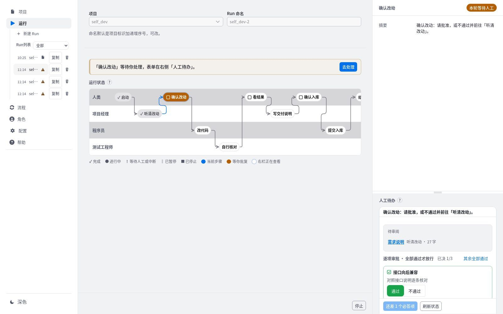

# 快速入门

GeniStudio 是一个流程驱动的自动化软件生产工场。人写下交付目标，工场按项目选定的流程，让各个角色依次写出文档和代码，并在决策点停下来，等人批复后继续。

本篇用不调用外部模型的 `stub` 后端走通一轮，约需五分钟。走通之后，再按[接入真实模型](#real-backend)换成 Cursor 或 Codex。

## 适用范围 {#fit}

- 适合已有成熟流程和交付件模板、需要 Agent 长时间连续工作的规模化开发。
- 不适合一次性的小任务，也不适合方向尚不确定的探索性开发。
- 角色、流程、每个节点使用的 Skill 与 MCP、Agent 后端都可以定制。

## 开始之前 {#before}

- 已按仓库 README 完成安装，浏览器能打开 GeniStudio，默认地址是 `http://127.0.0.1:8765/`。完整的安装说明在仓库的 `docs/install.md`。
- 准备一个 git 目录作为待开发项目。暂时没有也可以：项目不填工作区时，工场在自己目录下的 `workspaces/` 里为它新建一个空仓库。

## 五分钟走通一轮 {#first-run}

1. **选择后端。** 打开左栏“配置”→“Agent”，后端选 `stub`，按“写入 .env”。
   - 结果：保存说明显示已写入。`stub` 不调用外部模型，也不需要密钥。
2. **准备流程。** 打开左栏“流程”→“编辑”，在“选择流程”里选一个内置流程，查看它的节点。需求较明确、想先定规格再写代码时，可以选内置的“Spec Kit 规格驱动开发”：先写规格并由人审核与澄清，再制定方案、拆分任务、自动做一致性分析，实现后对照规格核对缺口。开发或优化 NPU 算子时，可以选内置的“NPU 算子开发（KDA）”：先写算子合同与方案草案，每轮只实现一个候选，在 SVB 板端分层验证并与基线做 A/B，达到晋升标准后接入算子库。内置流程只能查看；要修改，从“更多”→“复制为新流程”得到一份自己的流程。
   - 结果：画布按泳道列出各角色的活动和人类决策点。
3. **新建项目。** 打开左栏“项目”→“新建”，写标题，在“流程”里选上一步的流程，工作区选待开发项目的 git 目录，然后按“创建”。
   - 结果：页面提示“已创建项目”及项目标识，并进入这个项目。标识由标题自动生成，之后不再改变。
4. **启动一轮。** 打开左栏“运行”→“新建 Run”，在“项目”里选刚建的项目。右栏下方写交付目标，例如“为登录页增加记住我选项”，按“启动”。
   - 结果：中栏泳道逐格点亮，右栏上方的阶段标记变为“本轮运行中”。
5. **批复决策点。** 流程走到决策点时，泳道里那一格变成琥珀色，中栏上方出现“去处理”。在右栏“人工待办”里阅读待审阅的产物，选择决定，按“提交并续跑”。
   - 结果：批准后流程继续；选不通过时，按流程设定退回某个活动重做，或结束本轮。
6. **查看结果。** 点泳道里任意一格，右栏显示这一步的会话和产物。全部走完后，阶段标记变为“本轮已完成”。

> [!TIP]
> 走通一轮之后，建议接着读[核心概念](concepts.md)，了解项目、流程、Run、活动和决策点之间的关系。

## 接入真实模型 {#real-backend}

1. 打开“配置”→“Agent”，后端选“Cursor SDK”或“Codex SDK”。
2. 按“添加密钥”写入 API Key。Codex 也可以不写密钥，直接使用本机已登录的 Codex 账号。密钥只写入本机 `.env`，页面不回显。
3. “默认模型”留空时使用后端自己的默认模型。按“写入 .env”保存。
4. 回到“运行”新建一轮。之后每一轮都由真实模型执行，耗时和费用随流程长度增加。

各项设置的含义见[配置](config.md#agent)。

## 下一步 {#next}

- [核心概念](concepts.md)：读懂页面上的术语。
- [流程](workflow.md)：按团队自己的做法编排活动和决策点。
- [运行](run.md)：暂停、续跑、逐项批复与查看历次决定。
- [常见问题](faq.md)：启动失败、收不到飞书通知等情况的处理办法。
