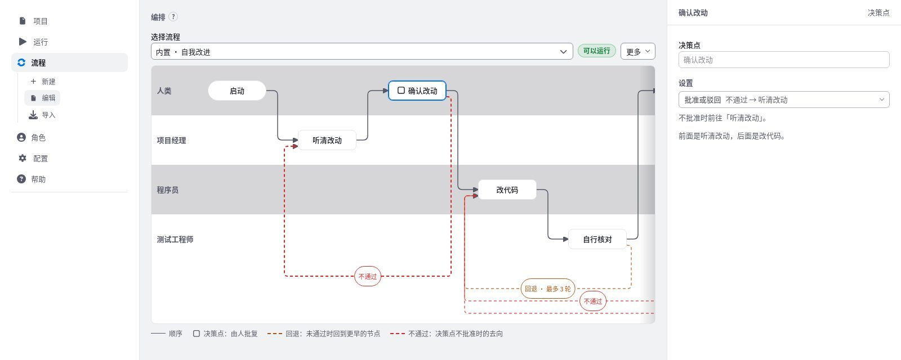

# 流程

流程规定每一轮按什么顺序、由哪些角色做什么，以及在哪里停下来等人决定。左栏“流程”下有“新建”“编辑”和“导入”。画布按泳道排列：人类泳道在最上面，放启动、结束和决策点；每个角色一行，放它负责的活动。

## 新建、复制与导入 {#create}

- **新建**：写标题，按“创建”。得到只有启动和结束的空流程。标识按标题自动生成，中文标题使用序号，创建后不再改变。
- **复制**：在“编辑”里载入一份流程，从“更多”→“复制为新流程”，写新标题。内置流程只能查看，要修改时先复制。
- **导入**：选择一份 `workflow.yaml`。内置标记不会带入。
- **导出**：“更多”→“导出 YAML”导出最近一次保存的版本。

## 编辑画布 {#edit}

1. 在“编辑”的“选择流程”里选一份，流程载入画布。选择框保持可用，随时可以换一份。
2. 按“添加节点”，或点连线中点的“+”，插入活动、决策点、并行或子图。从“添加节点”插入时，新节点放在选中节点之后。
3. 点一个节点，在右栏修改名称和设置；点空白处回到流程说明。
4. 用右栏的“前移”“后移”调整顺序，“删除节点”删除。启动和结束不能改名、删除或跳过。
5. 按“保存”，或按 <kbd>Ctrl</kbd>+<kbd>S</kbd>。

| 快捷键 | 作用 |
|------|------|
| <kbd>Ctrl</kbd>+<kbd>Z</kbd> | 撤销画布上的修改 |
| <kbd>Ctrl</kbd>+<kbd>Shift</kbd>+<kbd>Z</kbd> | 重做 |
| <kbd>Ctrl</kbd>+<kbd>S</kbd> | 保存 |

右栏左缘可以拖动，调整右栏宽度。

## 活动 {#activity}

- 在右栏“类型、角色与回退”里选择执行这一步的角色。新建活动时，用角色定义里的输入和输出作为初值。
- **输入**：这一步要读取的已有产物，可以为空。从下拉框里选更早活动的输出或“人类需求”；选“手写”时再填写产物名。点“输入”“输出”标题右侧的“添加”新增一项，点每项末尾的垃圾桶移除。产物名只能用小写字母、数字和下划线，并以字母开头。
- **输出**：这一步要写出的产物，至少一项。每项输出都要有模板。
- **模板**：服务器上的本地文件，或一个 `http`、`https` 链接。模板约束这项输出的结构，运行时交给角色照着写。本地文件须为 UTF-8 文本，不超过 256 KB。
  - 在模板编辑框里粘贴链接，或点“选择文件”，不需要另选类型：以 `http://`、`https://` 开头的是链接，绝对路径是本地文件。
  - 保存流程时，本地文件复制到 `workflows/<流程标识>/templates/`，随流程保存。之后改动原文件，不再影响这个流程；要换成新内容，点“更换”后重新选择文件或改填链接。
  - 已收入的模板可以点“查看”或“编辑”。编辑后保存流程，改动另存为新文件，历史版本仍引用原来的文件，回退版本时模板一起回到当时的内容。
  - 直接在服务器上改 `templates/` 下的文件，效果等同于原地覆盖：引用这个文件的历史版本也会随之变化。
  - 复制流程、存为子图时，用到的模板一起复制。导出 YAML 不含模板文件。
  - 内置流程只能查看：点活动可以看到输入、输出和补充说明，随流程保存的模板可以点“查看”阅读正文。
- **补充说明**：写给这一步角色的方法约束或注意事项，运行时附在提示词末尾。内置流程只能查看，复制后可以修改。
- **回退到**：结果没有达标时回到哪一个更早的节点重做；“最多循环”限制重做次数。次数用尽后转为回退升级，交给人决定。

## 决策点 {#gate}

决策点是由人批复的节点，只能放在人类泳道。在右栏“设置”里设定：

- **决定类型**：“批准或驳回”，或“择一（两路对照）”。择一用于“对照择一”的并行之后，见[并行](#parallel)。
- **不通过时**：不批准时的去向。可以前往某个活动重做，附言作为需要修复的问题交给它；也可以结束本轮。画布上用虚线表示。

## 决策项 {#gate-items}

需要逐条核对时，在决策点的右栏“决策项”里按“添加决策项”，为每一项写标题，需要时补一句说明，并标明是否必答。

- **全部通过才放行**：任一项不通过，即按“不通过时”的去向退回，并把该项原因交给那个活动。
- **只作核对清单**：逐项结论只作记录，最后仍由人选择批准或不通过。

有决策项的决策点，画布上的图标右上角显示条目数。一个决策点最多 30 项。运行时的操作见[逐项审批](run.md#gate-items)。

## 并行 {#parallel}

并行节点包含两条或更多支路，各支路同时执行，在汇合处按“汇合方式”处理：

- **合并各路**：把各路改动合并后继续。
- **对照择一**：各路改动先不合并，汇合处写出各路对照；紧随其后的“择一”决策点由人选定采用哪一路，未采用的改动留作补丁。

支路里的活动可以回退到同一支路里更早的活动。支路里不能放决策点，不能回退到支路以外，也不能再嵌套并行。

## 子图 {#subgraph}

- 子图是被当作一个节点引用的流程，用来复用一段固定步骤。
- 把一份流程存为子图：载入后从“更多”→“存为子图……”。
- 插入子图：“添加节点”→“子图”，选择一份。选中子图节点后，右栏“打开子图”进入它。
- 从上层流程打开子图后，标题下方的路径可以回到上层流程。

## 运行前检查 {#check}

选择框右侧的标记写着“可以运行”或“N 处待补”。它按启动时的规则检查当前画布：待补的项目列在右栏“运行前待补”，相关节点带红点。常见的待补项有：

- 活动还没有输出，或某项输出没有模板。
- 模板文件读不到。
- 并行支路里出现了不支持的写法，例如决策点、回退到支路以外或嵌套并行。

待补项不妨碍保存，但补齐之前，选用这份流程的项目不能启动。

## 版本、引用与删除 {#versions}

- 每次保存都留下一版。右栏“版本记录”列出各版的改动；“载入到画布”把旧版放回画布，保存后才生效。
- 右栏列出选用这份流程的项目，以及把它当作子图的流程。
- 删除在“更多”→“删除流程……”，删除前需确认。内置流程不能删除；仍被项目选用或被别的流程当作子图时也不能删除。

## 运行数据 {#stats}

“更多”→“显示运行数据”在各节点下方叠加历次运行的执行次数、耗时、回退、升级与驳回次数，鼠标悬停查看全部。再选一次“隐藏运行数据”收起。

## 生效时机 {#apply}

把流程选进项目后，从下一轮起按这份流程执行。修改并保存流程后，同样从下一轮起生效。
