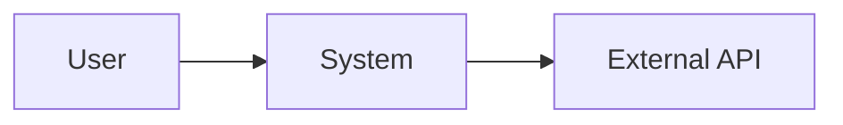
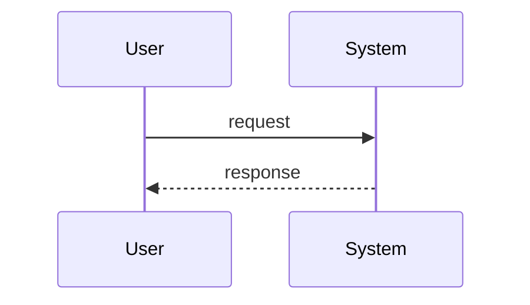

# {{system_name}} — 架构设计（Architecture Design）

**Version**: 1.0  
**Date**: YYYY-MM-DD  
**Status**: Draft | Approved

## Overview

（2–3 句：系统解决什么问题、架构风格、部署方式。）

## 1. 目标与范围

### 1.1 目标

- 映射 **AC-n**:

### 1.2 非目标

- 

### 1.3 质量目标

| 优先级 | 目标 | 度量 |
|--------|------|------|
| 1 | | |

## 2. 约束与上下文

- 技术 / 业务约束
- 外部系统

## 3. 方案策略

- 选定模式及理由
- 与现有代码的关系

## 4. 构建块（Building Blocks）

### AD-1: {{模块名}}

**职责**:  
**接口**:  
**数据**:  
**Covers AC**: AC-1, AC-2  
**影响文件/目录**:

### AD-2: {{模块名}}

（同上。）

## 5. 运行时视图（关键流）

## 6. 数据与错误处理

- 存储与一致性
- 错误传播策略

## 7. 风险与备选

| 风险 | 缓解 | 备选方案 |
|------|------|----------|
| | | |

## 8. 设计项 ↔ 验收标准

| AD-n | AC-n | 验证方式 |
|------|------|----------|
| AD-1 | AC-1 | |
