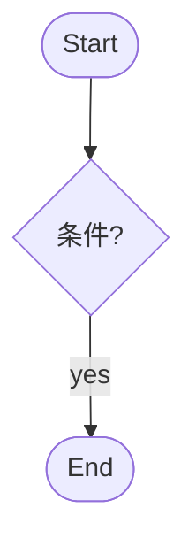

# {{project_name}} — 需求说明（Requirement Spec）

**Date**: YYYY-MM-DD  
**Status**: Draft | Confirmed  
**Phase**: draft | confirmed  
**Standard**: 对齐 ISO/IEC/IEEE 29148 思路；验收标准编号 **AC-n**

## 1. 目的与范围

[要解决的核心问题与系统边界。]

### 1.1 范围内

[本版本必须交付的能力。]

### 1.2 范围外

[明确排除项；未写入范围的内容不得扩展。]

## 2. 术语

| 术语 | 定义 |
|------|------|
| | |

## 3. 干系人与用户（无界面项目可省略）

| 角色 | 关键诉求 |
|------|----------|
| | |

## 4. 功能需求与验收标准

> 工厂约定：每条可检验需求使用 **AC-n**；可与 FR-n 并存。

### FR-001: {{标题}}

**Priority**: Must | Should | Could  
**EARS**: When {{触发}}, the system shall {{行为}}.

**Acceptance Criteria（AC-n）**:

- **AC-1**: Given {{上下文}}, when {{动作}}, then {{可观察结果}}
- **AC-2**: …

（按 FR-002、FR-003 重复。）

### 4.1 流程（可选）

## 5. 非功能需求

| ID | 类别 | 要求 | 可度量标准 | 验证方式 |
|----|------|------|------------|----------|
| NFR-001 | | | | |

## 6. 约束与假设

| ID | 约束/假设 | 说明 |
|----|-----------|------|
| CON-001 | | |

## 7. 验收标准汇总

| AC-n | 摘要 | 验证方式 |
|------|------|----------|
| AC-1 | | 测试 / 命令 / 可观察行为 |

## 8. 追溯矩阵

| Requirement | 来源 | 验证 |
|-------------|------|------|
| FR-001 / AC-1 | human_request | 测试 |

## 9. 待确认问题

| # | 问题 | 负责人 | 状态 |
|---|------|--------|------|
| 1 | | 项目经理 / 人类 | open |
