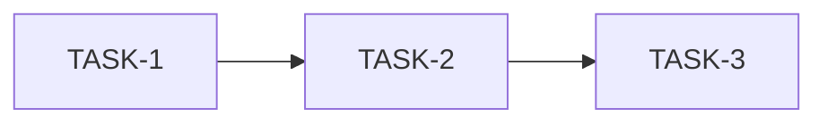

# 任务计划（Task Plan）

**Feature / Run**: {{name}}  
**Date**: YYYY-MM-DD  
**Status**: Draft | Approved  
**Based on**: requirement_spec, architecture_design

## Summary

| 指标 | 值 |
|------|-----|
| Total TASK-n | |
| 估计顺序 | 见下表 |

## 任务列表

| TASK-n | 标题 | 依赖 | 涉及路径 | 完成标准 | Covers AC | Covers AD | 验证方式 | UI（SCR/CMP） |
|--------|------|------|----------|----------|-----------|-----------|----------|---------------|
| TASK-1 | | — | | | AC-1 | AD-1 | 命令/测试 | — |
| TASK-2 | | TASK-1 | | | | | | SCR-1 |

### TASK-1: {{标题}}

**描述**:  
**完成标准**:  
**验证**: `命令…`  
**禁止**: 范围外改动

### TASK-2: {{标题}}

（同上。）

## 依赖关系

## 风险（可选）

| 任务 | 风险 | 缓解 |
|------|------|------|
| TASK-2 | | |
